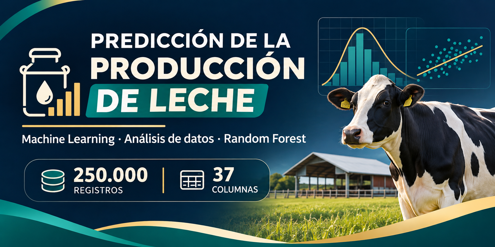

# 🐄 Predicción de la Producción de Leche en Vacas

**Proyecto académico de Machine Learning **

Desarrollo de modelos de aprendizaje automático para analizar y predecir la producción de leche en vacas, utilizando características relacionadas con el animal, su alimentación y su entorno.

## 🎯 Objetivo

Estimar la cantidad de litros de leche que produce una vaca mediante modelos de Machine Learning.

El problema principal es de **regresión**, con un experimento complementario de clasificación en tres niveles de producción: bajo, medio y alto.

## 📊 Conjunto de datos

| Característica | Valor |
|---|---:|
| Registros | 250.000 |
| Columnas | 37 |
| Duplicados | 0 |
| Filas retiradas | 0 |
| Variable objetivo | `Milk_Yield_L` |

### Variables analizadas

- Raza.
- Edad y peso.
- Etapa de lactancia.
- Alimentación.
- Consumo de agua.
- Condiciones climáticas.
- Características del manejo.

## 🔍 Análisis exploratorio de datos

Se realizaron procedimientos de auditoría, limpieza y exploración estadística.

### Estadística descriptiva

| Métrica | Resultado |
|---|---:|
| Media | 8,723 L |
| Mediana | 7,62 L |
| Desviación estándar | 5,76 L |
| Mínimo | 0 L |
| Máximo | 36,42 L |

La distribución presenta asimetría positiva, debido a la concentración de registros en producciones bajas e intermedias y una cola hacia valores altos.

También se analizaron los promedios de producción según raza y etapa de lactancia.

## ⚙️ Metodología

- División de datos: 80 % entrenamiento y 20 % prueba.
- Semilla aleatoria: 21.
- Validación cruzada: 5 particiones.
- Imputación de valores faltantes mediante pipeline.
- Exclusión de identificadores como predictores.

## 🤖 Modelos de regresión

Se compararon tres algoritmos:

- Random Forest Regressor.
- Decision Tree Regressor.
- Support Vector Regression (SVR).

### Resultados del modelo seleccionado

Random Forest obtuvo el mejor desempeño entre los tres modelos comparados.

| Métrica | Resultado final |
|---|---:|
| MAE | 2,6988 L |
| RMSE | 3,5284 L |
| R² | 0,6259 |

### Validación cruzada

- RMSE promedio: 3,534 L.
- Desviación reportada: ± 0,044 L.
- Particiones: 5.

## 🧠 Experimentos complementarios

### Clasificación

Se categoriza la producción en tres niveles:

- Baja.
- Media.
- Alta.

Se compararon Gaussian Naive Bayes, Decision Tree, Random Forest y SVC con kernel RBF.

Random Forest obtuvo el mejor resultado de clasificación, con un F1 macro de aproximadamente 0,6752 y una exactitud de 0,6791.

### Red neuronal

Se implementó una red neuronal MLP utilizando Keras, con dos capas ocultas densas de 64 y 32 neuronas, y una salida de tres clases.

Se utilizó EarlyStopping para controlar el entrenamiento.

## 🛠️ Tecnologías utilizadas

- Python.
- Google Colab.
- Pandas.
- NumPy.
- Matplotlib.
- Seaborn.
- Scikit-learn.
- TensorFlow / Keras.

## 📁 Estructura del proyecto

- `assets/`: imágenes y recursos gráficos.
- `notebooks/`: cuadernos de Google Colab.
- `resultados/`: gráficas y métricas.
- `README.md`: documentación del proyecto.

## 👥 Integrantes

- Valentina Fajardo Benítez.
- Ibeth Oriana Ruiz Manosalva.
- Joel Antonio Castro Mora.

## 📚 Fuente

Proyecto académico: Predicción de la producción de leche en vacas .
